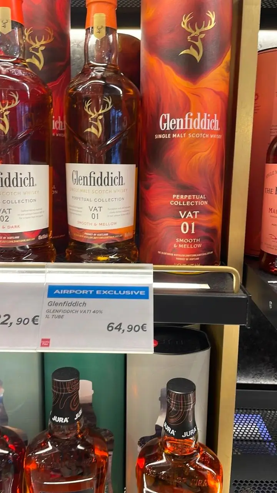
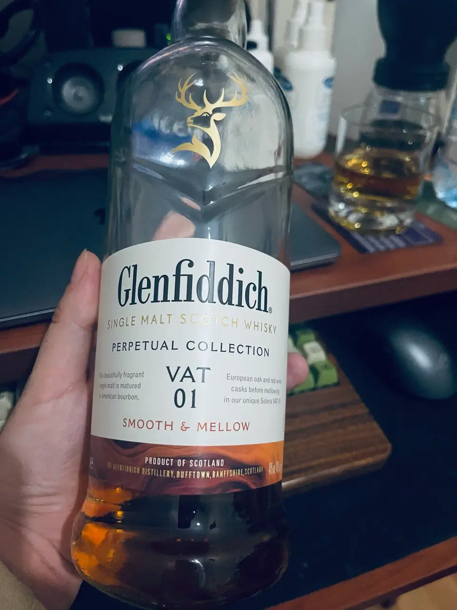

I never wrote proper tasting notes for this bottle, so this is a short one.

I got it from the Istanbul Airport duty free in May 2023. It was an airport exclusive in a 1 litre tube, priced at 64.90 €.

I opened it one evening in October 2023: I'd started the night outside with beer, and at home I switched to "polishing mode" with this.

## At a Glance

| | |
|---|---|
| **Whisky** | Glenfiddich Perpetual Collection VAT 01 ("Smooth & Mellow") |
| **Type** | Single Malt Scotch Whisky |
| **Region** | Speyside |
| **Casks** | American bourbon, European oak and red wine casks, then mellowed in a Solera vat |
| **ABV** | 40% |
| **Size** | 1 L |
| **Price paid** | 64.90 € (Istanbul Airport duty free, May 2023) |

## Tasting Notes

I didn't write any down for this one.

## Verdict

I personally like stronger whiskies. With Aberlour 12, even double after double didn't do much for me, and VAT 01 was a bit like that for me too. Smooth & mellow is exactly what it says on the label, and that's just not my style.

Still, the bottle was almost gone by April 2024, so it clearly didn't go to waste.

Sláinte! 🥃
