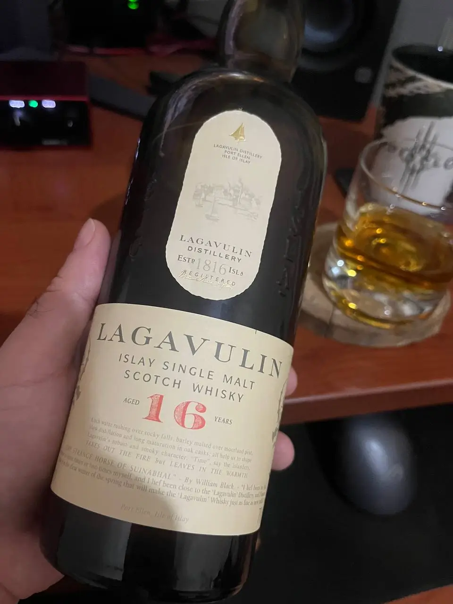
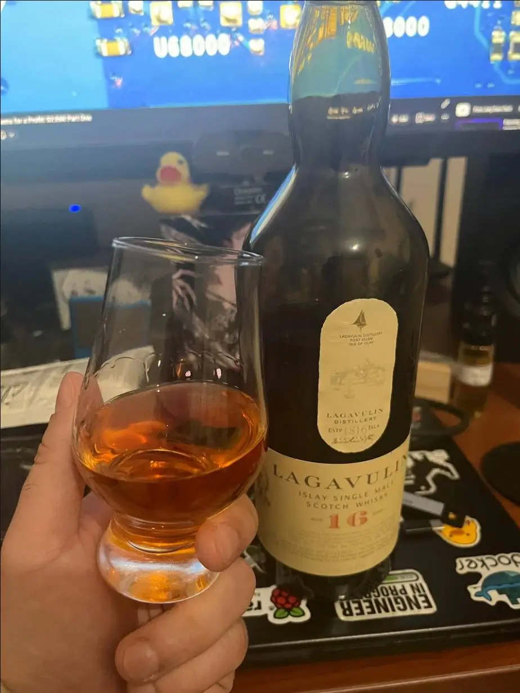

Let me present tonight's companion: **Lagavulin 16** 😬 I've finally got my wish 😅

I've been saying it for years: *"I really like Lagavulin 16. Whenever I can find it, it's my choice. If I can't find anything, Black Label."* Prices kept climbing, so it took a while. This bottle was a gift from a very dear friend, which gives it extra sentimental value ☺️

## At a Glance

| | |
|---|---|
| **Whisky** | Lagavulin 16 Year Old |
| **Type** | Single Malt Scotch Whisky |
| **Region** | Islay |
| **ABV** | 43% |
| **Size** | 70 cl |
| **Price** | Gift. Later bought another one in Cyprus for 80 € (70 cl) |

## Tasting Notes

I didn't write a full nose / palate / finish breakdown for this one. It's the bottle I *enjoy* rather than analyse. Here's what I did note down:

**Nose:** The moment I opened the bottle, peat smoke wrapped itself around me. Exactly what I wanted 😁

**Strength:** A couple of days later I poured a single, even a bit less than that, and it hit me like crazy. Compared to mellower malts like Aberlour 12, where even double after double didn't do much for me, this one has real character.

## Second Bottle, Same Joy

A few months later I came back from Cyprus with a fresh bottle. It was 80 € for 70 cl there, while the same bottle had gone up to 5500 TL back home. That was roughly 1.5 times cheaper.

When I opened it, peat and smoke filled my whole room again 😍

And it was the bottle I picked to say goodbye to 2025, too:

## Verdict

Lagavulin 16 is my benchmark for smoky whisky. When I review other peated bottles, I keep coming back to the same comparison: *"It's no Lagavulin 16, of course, but…"* Only [Caol Ila 12](/posts/caol-ila-12-tasting-notes/) has come close on the nose so far.

If it were a litre at the same price, I'd buy it without a second thought 🫠

Sláinte! 🥃
