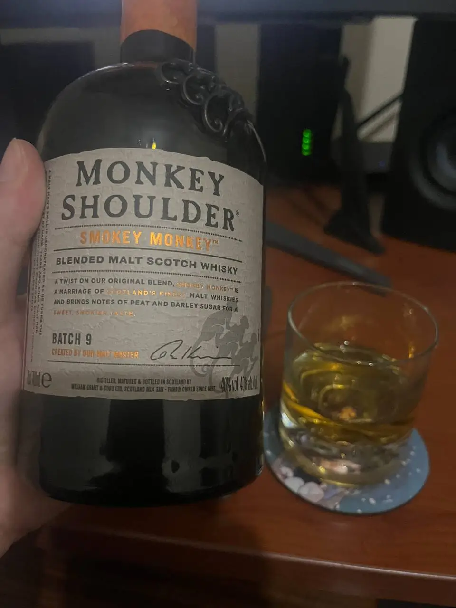

I'd picked up Monkey Shoulder's Smokey Monkey a week earlier, after friends recommended it, and I opened it tonight.

As soon as I opened it, the smell of smoke filled my room 😍 It's no Lagavulin 16, of course, but it's not bad at all. I liked it. I'm especially into smoky whiskies like this.

I'm not a gourmet. I just tried to scribble down what I felt.

## At a Glance

| | |
|---|---|
| **Whisky** | Monkey Shoulder Smokey Monkey (Batch 9) |
| **Type** | Blended Malt Scotch Whisky |
| **ABV** | 40% |
| **Price paid** | 1400 TL / 70 cl (Carrefour, June 2024) |

## Tasting Notes

**Nose:** True to its character, salt and smoke dominate. Underneath I get a little peat and fresh, green notes, especially grass and citrus.

**Palate:** On the first taste it feels stronger than the 40% on the label, which I think is a good thing. Smoke and salt above all, with caramel and maybe chocolate in the undertones.

**Finish:** After the sip, along with the smoke, it leaves more of a cocoa and coffee taste on the palate.

## Pairing

As I usually do with smoky ones, I opened some chocolate. Dried fruit would also go really well with this.

## Verdict

Its smoke is definitely better than Black Label's and Teacher's. At 1.4k TL it was a bit pricey, but there aren't many whiskies in that price range with this character, so it's fair.

A few months later I'd say this: **Smokey Monkey might be my favourite value-for-money peated whisky on the market.** I don't usually go for blends, but this one is really good. Don't expect a Talisker or a Lagavulin, but if you want something a bit smoky at a reasonable price, buy this instead of Black Label.

Sláinte! 🥃
