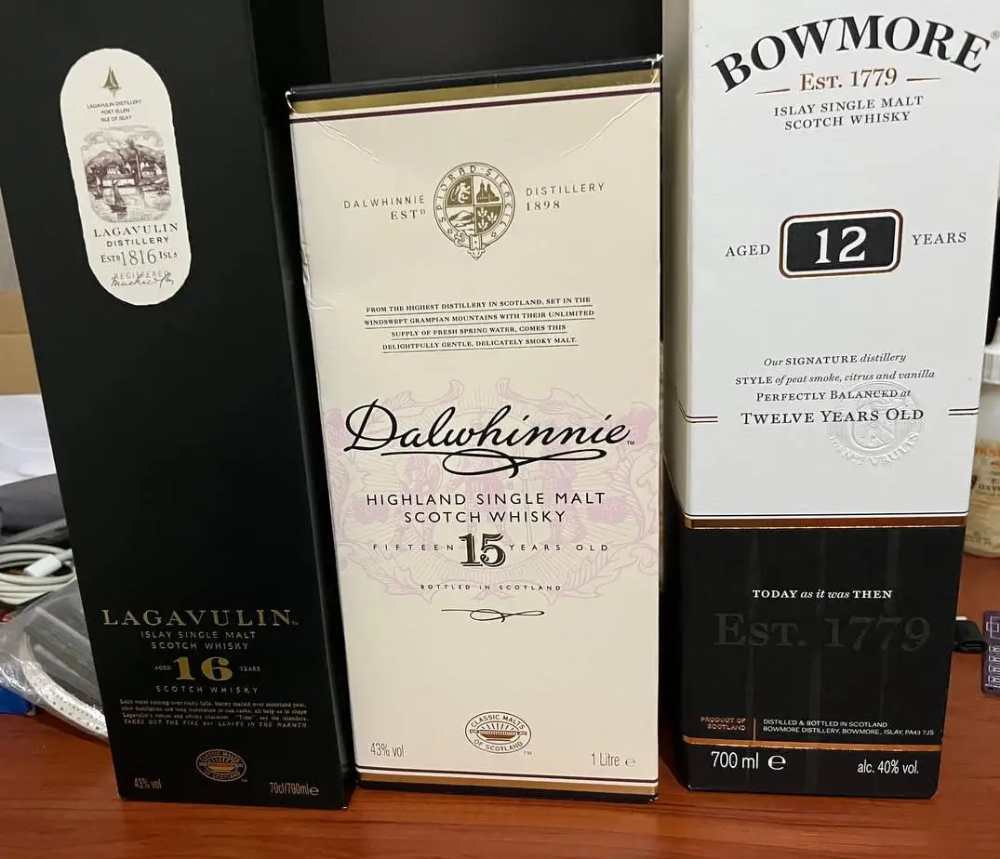

Today I opened one of my spoils from Cyprus: Bowmore 12.

I came back with three bottles from that trip: Lagavulin 16, Dalwhinnie 15 and this one. Lagavulin is already a favourite, and friends from another group had praised the other two, so let's see.

## At a Glance

| | |
|---|---|
| **Whisky** | Bowmore 12 Year Old |
| **Type** | Single Malt Scotch Whisky |
| **Region** | Islay |
| **ABV** | 40% |
| **Size** | 70 cl |
| **Price paid** | 49 € (Cyprus) |

## Tasting Notes

**Nose:** Whether you smell it from the bottle or the glass, it's lightly smoky, but it smells of loads and loads of vanilla.

**Palate:** Because of its initial sharpness and the alcohol, it starts with alcohol and woody flavours, then continues with some lemon. This lemon starts out quite sweet, then dominates in the throat for a while.

**Finish:** As the sip ends, the lemon and orange fade, the smoke left behind becomes noticeable again, and the vanilla takes over.

## Verdict

I liked it a lot. It's relatively light compared to the heavy smoky ones, but very aromatic and pleasant to drink. It has exactly the characters I love.

It was a brand I'd wanted to try for a while, and I'm glad I did.

Sláinte! 🥃
