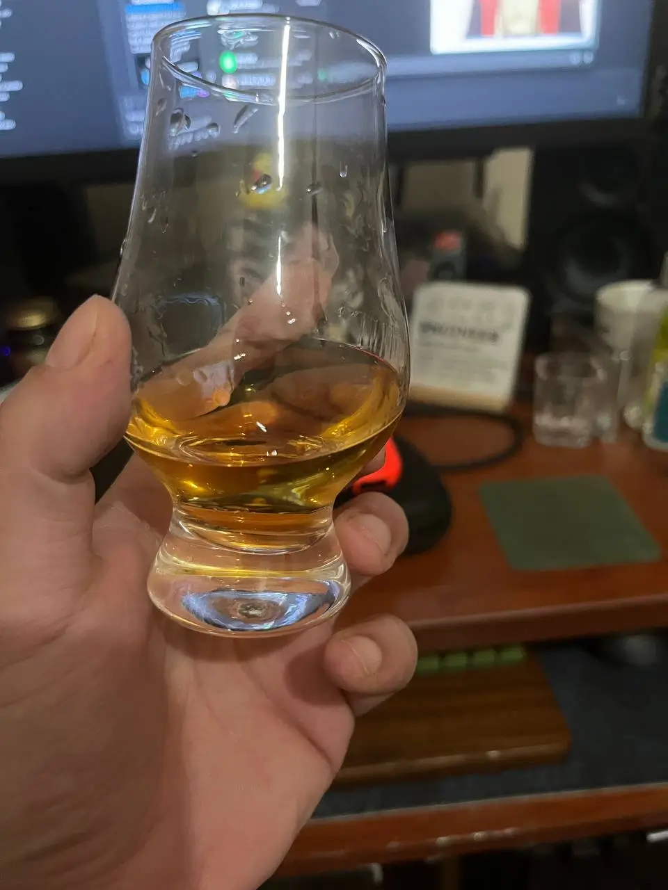

Tonight's companion was a gift from a friend. Let me sip it and write down my first impressions 😊

## At a Glance

| | |
|---|---|
| **Whisky** | The Famous Grouse |
| **Type** | Blended Scotch Whisky |
| **ABV** | 40% |
| **Price** | Gift |

## Tasting Notes

As someone who loves smoky whisky, it felt weak to me. It's definitely a summer whisky, and that's partly why I opened it now, hehe.

**Nose:** Mostly a grainy, wheat-like smell. But if you keep sniffing, I also got grape and honey deep down.

**Palate:** You definitely taste the alcohol, plenty of it, throughout. On the side, it starts honey-heavy, with a light grape and sugar taste. Towards the end it leaves a sweet taste, not quite caramel, more like chocolate, and gets sweeter.

**Finish:** A light, milk-chocolate-like taste on the tongue and a very faint honey.

**Smoke:** I couldn't get any at all 😕 Maybe I've gotten too used to the heavily peated ones.

## Pairing & Serving

I sip it neat, but salty snacks would go fine alongside.

If you're drinking it neat and find the alcohol too dominant, I'd suggest adding 2–3 drops of water to a single to open up the aromas.

## A Little Cocktail Experiment

A week later, since I wasn't loving it neat, I mixed it with the only liqueur I had at home, **Frangelico**, at 2:1 (2 parts whisky, 1 part Frangelico), purely on gut feeling. It turned out not bad at all, basically a hazelnut liqueur whisky, hehe.

Then I did some research (okay, I asked ChatGPT 😅) and it turns out there's a cocktail called the **Nutty Irishman**: you add Irish cream and some more ice to what I'd made. It's also served as a shot, and depending on the cream and liqueur ratio, even in a mug. I was sipping mine from a Glencairn glass, hehe.

## Verdict

Looking at the price, it's good value. I'd recommend it as a summer whisky, and if you make cocktails, use it there.

Sláinte! 🥃
