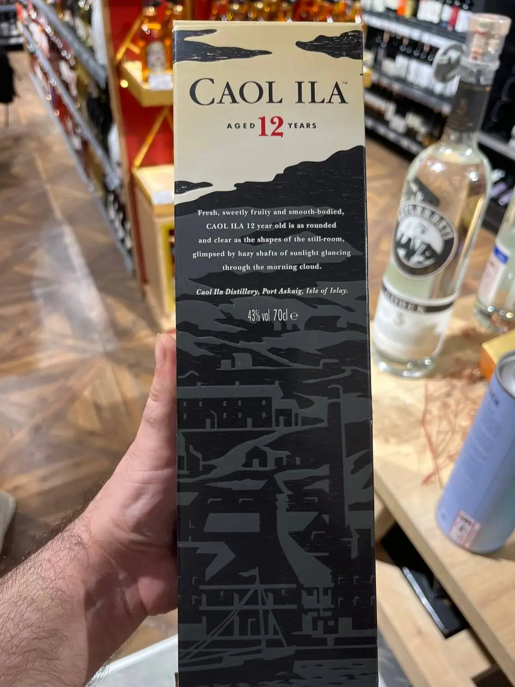

Caol Ila 12 showed up at Carrefour Gourmet for 3000 TL, so I picked one up to try. On paper its specs looked really good.

I realised I never wrote anything about it, so here goes :)))

## At a Glance

| | |
|---|---|
| **Whisky** | Caol Ila 12 Year Old |
| **Type** | Single Malt Scotch Whisky |
| **Region** | Islay |
| **ABV** | 43% |
| **Size** | 70 cl |
| **Price paid** | 3000 TL (Carrefour Gourmet, September 2025) |

## Tasting Notes

**Nose:** The moment you open it, loads of smoke, properly peaty and smoky. Almost as smoky as Lagavulin. It instantly became my second smokiest whisky (by nose; if I can ever find Talisker Dark Storm again, this one will drop to third 😅). Alongside it there's sea salt, a very faint honey and walnut?, and right at the very bottom fresh fruit like green apple and lemon.

**Palate:** Let me say it up front: there's sea salt throughout the whole thing, since it's a smoky whisky. Talisker had this too. As you sip, it definitely opens with a lovely vanilla, together with fresh citrus like orange and tangerine, and a little caramel, but in the finish the citrus takes over. I expected chocolate in this combo too, but personally I couldn't find any.

**Finish:** As it warms the back of the nose, citrus like lemon and orange dominates, with a little green apple, like fresh fruit.

## Verdict

I liked it. I'll buy it again. It instantly made it into my top 5 smoky single malts.

Sláinte! 🥃
