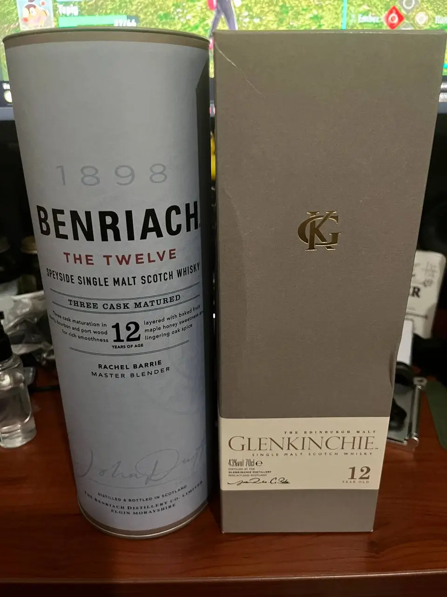

Tonight's new companion: BenRiach 12.

I bought it a few months ago together with a [Glenkinchie 12](/posts/glenkinchie-12-tasting-notes/), and only now got around to opening it.

Let me keep my notes short.

## At a Glance

| | |
|---|---|
| **Whisky** | BenRiach The Twelve |
| **Type** | Single Malt Scotch Whisky |
| **Region** | Speyside |
| **Casks** | Three cask matured: sherry, bourbon and port |
| **Price paid** | 3300 TL together with Glenkinchie 12 (October 2025) |

## Tasting Notes

**Nose:** Very citrusy. Orange and grape dominate, with a bit of honey and cookie-like smells coming from underneath.

**Palate:** Starts with honey and dark chocolate, moves on to orange and then lemon, and towards the end it gets close to spices like cinnamon.

**Finish:** It leaves orange and almost… a sweet mint…? kind of taste on the palate. I liked this aftertaste.

## Verdict

A nice one. That orange and sweet-mint aftertaste is what stayed with me.

Sláinte! 🥃
