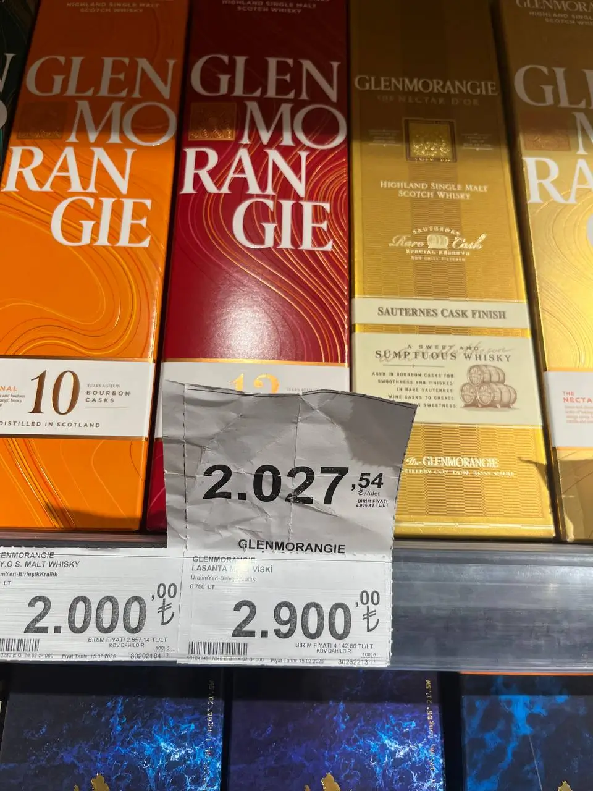

Oh, it's been a year since I bought this and I never opened it :D I just opened the bottle.

I picked it up in April 2025 during a Carrefour sale on all spirits. The Lasanta (the one in the red box) had dropped from 2900 TL to about 2000 TL.

## At a Glance

| | |
|---|---|
| **Whisky** | Glenmorangie The Lasanta 12 Year Old |
| **Type** | Single Malt Scotch Whisky |
| **Region** | Highlands |
| **Size** | 70 cl |
| **Price paid** | ~2000 TL on sale (down from 2900 TL, Carrefour, April 2025) |

## Tasting Notes

**Nose:** Lots of honey, fruit, and pear/apple. Underneath, a very faint lemon-like smell too.

**Palate:** The moment it hits your mouth, it's mostly fruit, but not sharp. Softer fruits, like citrus softened with vanilla or honey / sugar. You know those round milky bonbons? That's exactly the taste I'm trying to describe. As the sip goes down, this gives way to sharper flavours like lemon / orange.

**Finish:** Short, not very long. I wish it were longer. It starts with a lovely vanilla cream-like taste, but the lemony fruit flavours that come after kind of clean it up on the way down.

## Verdict

A proper summer whisky. I recommend it to those who like this style.

Sláinte! 🥃
