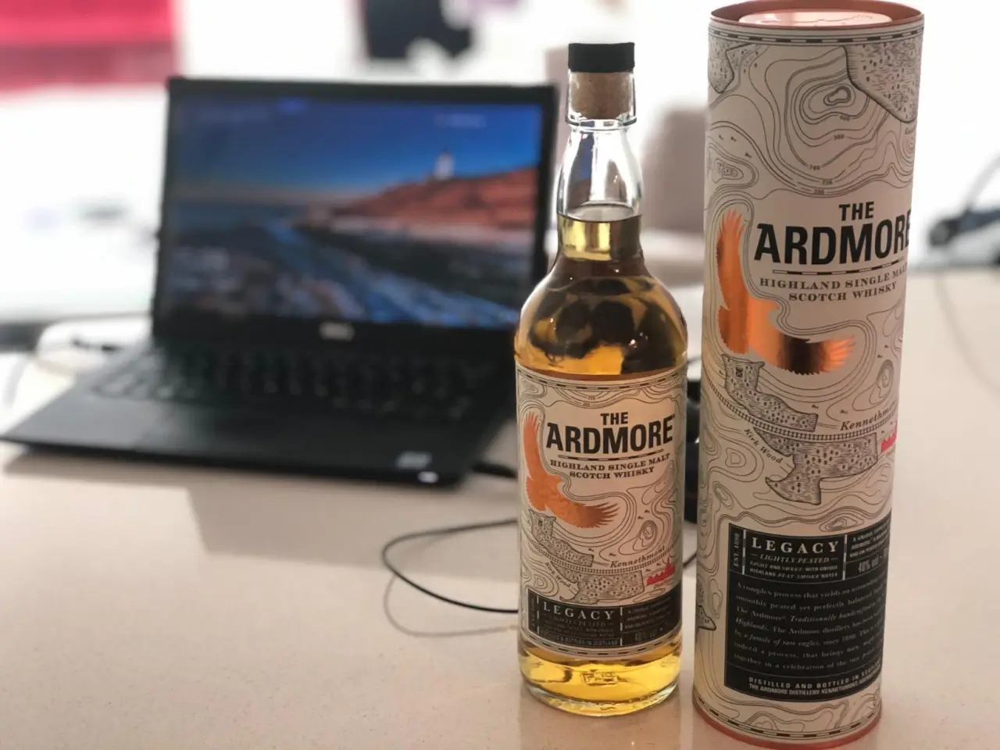

I just opened the Ardmore Legacy.

It's a Highland single malt Scotch from the Ardmore distillery in Kennethmont, Aberdeenshire, which has been around since 1898. The Legacy is a marriage of peated and unpeated Ardmore malt, which is why the label says "lightly peated". Fun fact: the same distillery supplies the malt for [Teacher's](/posts/teachers-highland-cream-tasting-notes/).

I bought it back in August during Carrefour's big spirits sale. The shelves were wiped out everywhere, and this was one of the few things I could still find at the last minute. I'd been curious about it anyway, and it was down from 2600 TL to 2100 TL.

It's pale in colour, and I have to say I liked how it performed quite a bit.

The photos aren't mine this time. You know I'm hopeless at taking them, haha :D The cover photo is from [The Whisky Exchange](https://img.thewhiskyexchange.com/1400/ardob.non1.jpg).

*Photo: a customer review on [Amazon.co.uk](https://m.media-amazon.com/images/I/716snQgToaL.jpg)*

## At a Glance

| | |
|---|---|
| **Whisky** | The Ardmore Legacy |
| **Type** | Highland Single Malt Scotch Whisky, lightly peated |
| **Region** | Highlands (Kennethmont, Aberdeenshire) |
| **ABV** | 40% |
| **Size** | 70 cl |
| **Price paid** | 2100 TL, down from 2600 TL (Carrefour sale, August 2026) |

## Tasting Notes

**Nose:** A light peat smell, and next to it a hint of fresh fruit, something like green apple?

**Palate:** It's definitely a strong whisky. Smoky peat, with vanilla and just a little lemon.

**Finish:** Not very long, but what's there isn't bad at all. It leaves a spicy, black-pepper-like taste, with a bit of that peppery bite here and there. The peat makes sure you know it was there, too. Once the pepper fades, vanilla takes over at the very end.

## Verdict

When this bottle runs out, I'll buy it again if I see it on sale.

I recommend it. Enjoy!

Sláinte! 🥃
